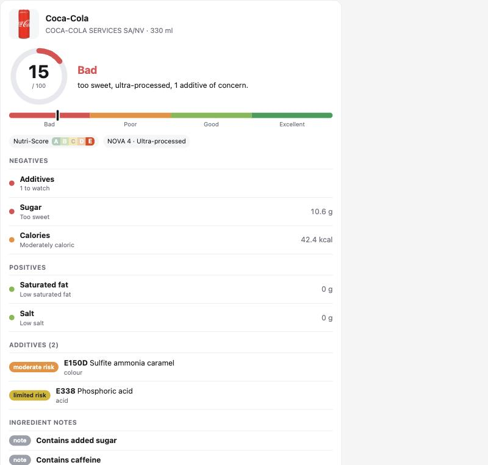

# FoodChecker

**An open-source food label checker for ChatGPT and Claude.** Ask "is this healthy?" with a barcode, a product name or a photo of the label. You get a 0-100 score with the reasons, the way Yuka or Oasis would show it, but inside your chat and with a scoring method anyone can read.



| Score | Rating |
| --- | --- |
| 75-100 | Excellent |
| 50-74 | Good |
| 25-49 | Poor |
| 0-24 | Bad |

- **Nutrition:** based on Nutri-Score 2023.
- **Additives:** each one has a risk level and a cited reason.
- **Processing:** based on NOVA, with a note on why a food counts as ultra-processed.
- **Alternatives:** suggests healthier products in the same category.
- **Data:** over 3 million products from [Open Food Facts](https://world.openfoodfacts.org). Labels you photograph are scored too, even products that aren't in the database.

How the score is built: [docs/METHODOLOGY.md](docs/METHODOLOGY.md).

## How it works

One [MCP](https://modelcontextprotocol.io) server serves both assistants. ChatGPT and Claude both implement the open **MCP Apps** standard, so the same score card renders inline in each of them:

```
ChatGPT / Claude  ──MCP──▶  FoodChecker server  ──▶  Open Food Facts API
       ▲                         │
       └──── score card (MCP Apps UI) + text summary
```

| Tool | What it does |
| --- | --- |
| `check_food` | Look up a product by barcode or name, and score it |
| `analyze_label` | Score a product from its label (photo or pasted text), including US per-serving labels |
| `find_healthier_alternatives` | Find similar products that score clearly higher |
| `explain_additive` | Explain an additive by E-number or name ("E471", "Red 40") with its risk level and sources |

All tools are read-only and need no login.

## Run it locally

```bash
npm install
npm run dev
```

- Open http://localhost:3000/preview?q=coca-cola to see the score card in a browser.
- `npm test` runs the scoring tests.
- `npm run smoke` calls every tool over MCP against live data while the server is running.

## Add it to ChatGPT

You need a public URL (see [Deploy](#deploy)). ChatGPT can't reach `localhost`.

1. Go to **chatgpt.com/plugins**, click **+**, then **Add custom MCP server**.
2. Server URL: `https://your-deployment/mcp`. Authentication: **No authentication**.
3. Create it, then ask: "Is Nutella healthy?"

To list it in the ChatGPT app directory, follow OpenAI's submission flow at platform.openai.com/plugins. FoodChecker already supports two of its requirements through environment variables:
- `OPENAI_APPS_CHALLENGE`: the domain-verification token, served at `/.well-known/openai-apps-challenge`.
- `CHATGPT_WIDGET_DOMAIN`: your widget origin.

You'll also need a privacy policy URL, a terms URL, test prompts and a demo video.

## Add it to Claude

- **claude.ai or Claude Desktop:** go to **Customize → Connectors → Add custom connector**, paste `https://your-deployment/mcp`, and choose **No sign-in**. The score card renders on web, desktop and mobile.
- **Claude Code, remote server:** run `claude mcp add --transport http foodchecker https://your-deployment/mcp`.
- **Claude Code, local server:** run `claude mcp add foodchecker -- npx tsx /path/to/repo/src/stdio.ts`.
- **Claude Code plugin with a usage skill:** this repo is a plugin marketplace. First edit the URL in `plugins/foodchecker/.mcp.json` to point at your deployment. Then run:

  ```
  /plugin marketplace add <github-owner>/<repo>
  /plugin install foodchecker@foodchecker
  ```

Claude Code shows text, not the score card. The text summary carries the same information.

## Deploy

The server is a standard web `Request → Response` handler (`src/app.ts`), so it runs almost anywhere.

- **Docker** (Render, Fly.io, Railway, any VPS): `docker build -t foodchecker . && docker run -p 3000:3000 foodchecker`
- **Vercel:** `vercel deploy`. `vercel.json` builds the project and routes everything to `api/index.js`.
- **Plain Node:** `npm run build && npm start`

Set `OFF_USER_AGENT` to `FoodChecker/0.1.0 (your contact email)`. Open Food Facts asks every app to identify itself. See `.env.example` for the other settings.

**Rate limits:** Open Food Facts allows roughly 15 product lookups and 10 searches per minute per IP. FoodChecker caches results in memory (products for 12 hours, searches for 1 hour). For heavy traffic, load the [Open Food Facts data dump](https://world.openfoodfacts.org/data) into your own database.

## Project layout

```
src/core/        scoring engine: Nutri-Score 2023, additive table, ingredient parser, 0-100 score
src/off/         Open Food Facts client and data normalisation
src/mcp/         MCP server, tool definitions, score-card widget, text summaries
src/app.ts       web handler: /mcp, /preview, landing page
src/http.ts      Node server       src/stdio.ts   local stdio server
plugins/         Claude Code plugin (MCP config + food-check skill)
test/            scoring tests     scripts/       smoke test, dev MCP Apps host
```

## Contributing

The most useful contributions are:

- **Additive table** (`src/core/additives.ts`): challenge a risk level with a source, or add a missing additive and its label names in your language.
- **Ingredient parsing** (`src/core/ingredients.ts`): label wording that gets missed. Add a test case in `test/scoring.test.ts`.
- **Product data:** fix the product on [Open Food Facts](https://world.openfoodfacts.org) and everyone benefits.

`npm run dev:host` builds a small MCP Apps host on the official `AppBridge`. Then open `/dev/host?barcode=…` to check the widget the way ChatGPT and Claude embed it.

## License and data

- **Code:** MIT.
- **Product data:** © Open Food Facts contributors, under the [Open Database License](https://opendatacommons.org/licenses/odbl/1-0/). Product images are under CC BY-SA. Keep the attribution that the score card and text summaries show.

FoodChecker gives general information about packaged food. It is not medical advice.
